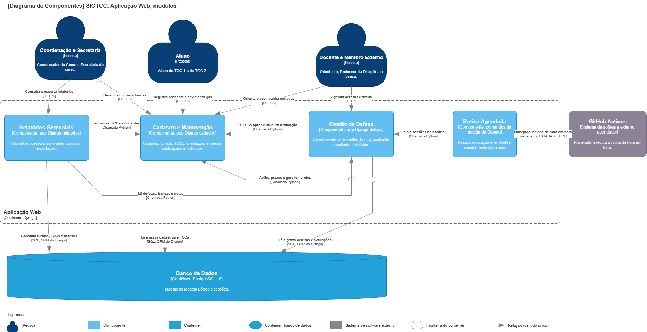
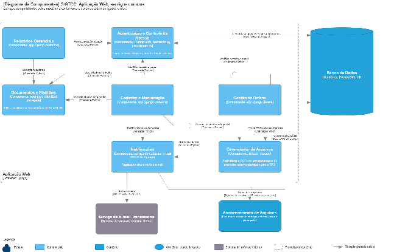
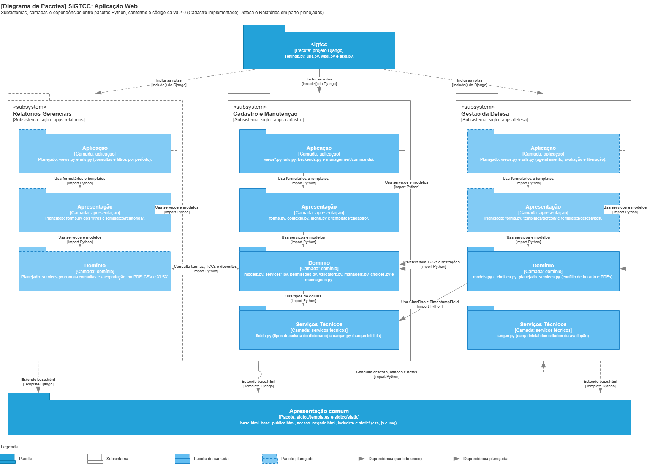
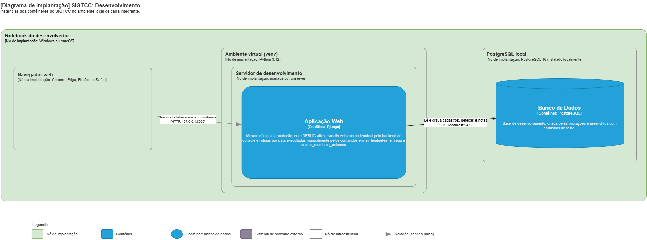
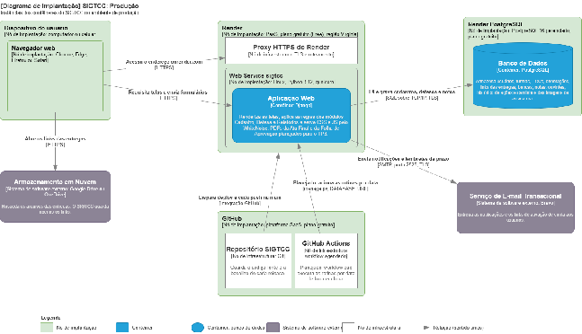

**PLANO DE GERÊNCIA DE CONFIGURAÇÃO DO SOFTWARE (PGCS)**

| Nome do Projeto: | Sistema de Gestão de TCC do NUCOMP-UEA (SIGTCC) |
| :---- | :---- |
| **Instituição:** | UEA – Universidade do Estado do Amazonas (NUCOMP) |
| **Responsável:** | Célio Benjamim |
| **Data:** | 25/10/2026 |

# **Controle do Documento e Histórico de Revisões**

| Versão | Data | Descrição da Alteração | Autor / Responsável |
| :---- | :---- | :---- | :---- |
| **1.0** | 18/10/2026 | Estruturação inicial do PGCS para o marco TP2: arquitetura MVT, organização de diretórios, GitFlow, padronização de commits, modelo de Pull Request e baselines. | Célio Benjamim |
| **1.1** | 20/10/2026 | Incorporação do ambiente multiplataforma (Windows e macOS), substituição do lint.bat pelo pre-commit, fluxo SDD (specs/ e .specify/), definição de logs em stdout e arquitetura de implantação em produção (Vercel, Neon, Vercel Blob, Brevo e GitHub Actions). | Célio Benjamim |
| **1.2** | 25/10/2026 | Revisão para a Baseline 2 (TP2, 25/10/2026): produção no Render (substitui Vercel, Neon e Vercel Blob), e-mail pelo Brevo por SMTP, log de acesso na saída padrão, pre-commit implantado, Histórias de Usuário v3.4, nova seção 2.4 com os diagramas de arquitetura e atualização dos itens de configuração, da árvore de diretórios, das variáveis, das dependências, das branches, do modelo de Pull Request, das baselines e do rito de auditoria. | Célio Benjamim |

# **1\. Introdução e Gerência de Configuração**

Este Plano de Gerência de Configuração de Software (PGCS) formaliza as políticas de controle de versão, estratégias de ramificação, regras de escrita de commits, ciclo de vida de Pull Requests, arquitetura de pastas, auditorias técnicas e linhas de base (baselines) do Sistema de Gestão de TCC do NUCOMP-UEA (SIGTCC).

O SIGTCC centraliza o fluxo dos Trabalhos de Conclusão de Curso da Escola Superior de Tecnologia da UEA em três módulos integrados: Cadastro e Manutenção, Gestão da Defesa e Relatórios e Informações Gerenciais. O sistema é concebido como uma aplicação web responsiva em Python 3.12 e Django, utilizando banco relacional PostgreSQL 16, desenvolvida em estações Windows e macOS e implantada em plataformas gratuitas de hospedagem.

A condução da gerência de configuração observa os preceitos normativos da IEEE Std 828-2012 (Standard for Configuration Management in Systems and Software Engineering), os processos de ciclo de vida da ISO/IEC/IEEE 12207:2017 e as características de qualidade de software da ISO/IEC 25010\.

## **1.1 Escopo da Configuração**

Este plano rege os artefatos técnicos versionados no repositório oficial do projeto:

* Código-fonte Python, rotas, regras de negócio e camada de acesso a dados;

* Interfaces web, gabaritos de apresentação e folhas de estilo;

* Scripts de banco de dados e migrações estruturais do ORM;

* Configuração das verificações automáticas de qualidade, executadas a cada commit em Windows e macOS (.pre-commit-config.yaml);

* Especificação formal de dependências de execução e de desenvolvimento do ambiente (requirements.txt e requirements-dev.txt);

* Arquivo de implantação na plataforma de hospedagem (render.yaml);

* Comandos de gestão do Django para as rotinas por data, a carga inicial e a carga de demonstração (management/commands/);

* Especificações, planos e tarefas de cada feature, produzidos no fluxo de desenvolvimento orientado a especificação (specs/ e .specify/);

* Diagramas de arquitetura e de sequência (docs/arquitetura/ e docs/diagramas/);

**Fronteira com a Gestão Documental:** Os artefatos de planejamento gerencial (Termo de Abertura, Matriz de Requisitos, EAP, Plano de Integração, Modelo Lógico e Histórias de Usuário) são mantidos no Google Drive institucional e no quadro Trello do projeto, que permanecem como fonte oficial. O diretório docs/fonte/ do repositório guarda cópias desses artefatos, convertidas em Markdown, apenas como referência para o desenvolvimento; em caso de divergência, prevalece a versão do Google Drive. Versões anteriores de um documento ficam em docs/fonte/anteriores/ apenas enquanto algum teste depender delas (é o caso das Histórias de Usuário v3.3, até a revisão da spec 002; índice Q-121).

## **1.2 Itens de Configuração (Configuration Items \- CIs)**

| Identificador | Item de Configuração (CI) | Descrição do Componente | Localização no Repositório |
| :---- | :---- | :---- | :---- |
| **CI-01** | Aplicação Backend e Lógica de Negócio | Módulos Django (apps), regras de domínio, validações, serviços e comandos de gestão. | sigtcc/apps/ |
| **CI-02** | Esquema de Banco de Dados | Modelos relacionais, migrações versionadas e cargas iniciais (data migrations). | sigtcc/apps/\*/migrations/ |
| **CI-03** | Camada de Apresentação (Frontend) | Gabaritos de tela (templates) e recursos estáticos (static). | sigtcc/templates/ e sigtcc/static/ |
| **CI-04** | Protótipo Navegável de Telas | Telas estáticas homologadas no marco TP1, publicadas no GitHub Pages. | Branch dedicada prototype |
| **CI-05** | Especificação de Pacotes | Dependências de execução (instaladas na hospedagem) e ferramentas de desenvolvimento. | requirements.txt e requirements-dev.txt |
| **CI-06** | Parâmetros de Qualidade | Regras de análise estática, formatação PEP 8, verificação a cada commit e padronização de quebras de linha. | .flake8, pyproject.toml, .pre-commit-config.yaml e .gitattributes |
| **CI-07** | Registro de Alterações | Histórico de modificações associado às baselines. | CHANGELOG.md |
| **CI-08** | Matriz de Requisitos | Cópia de referência da Matriz de Requisitos de 17/10. | docs/fonte/Matriz\_Requisitos\_17\_10.md e .xlsx |
| **CI-09** | Histórias de Usuário, Modelo Lógico e Cronograma | Cópias de referência das Histórias de Usuário (v3.4), do Modelo Lógico e Dicionário de Dados e do cronograma. | docs/fonte/Historias\_de\_Usuario\_v3\_4.md, Modelo\_Logico\_e\_Dicionario\_18\_10.md e Cronograma\_18\_10.md |
| **CI-10** | Configuração de Implantação | Blueprint do Render (serviço web, banco, build, início e variáveis não secretas) e configurações lidas do ambiente. | render.yaml e sigtcc/settings.py |
| **CI-11** | Rotinas por Data | Comandos de expiração de Membros Externos e de lembretes de prazo; agendamento automático planejado (seção 9.4). | sigtcc/apps/cadastro/management/commands/ |
| **CI-12** | Diagramas de Arquitetura | Diagramas C4 de componentes e de implantação e diagrama de pacotes (seção 2.4). | docs/arquitetura/\*.drawio |
| **CI-13** | Diagramas de Sequência | Diagramas de sequência dos casos de uso (24/10), uma página por caso de uso. | docs/diagramas/Diagramas\_Sequencia\_24\_10.drawio |
| **CI-14** | Especificações das Features | Especificação, pesquisa técnica, plano, tarefas, roteiro de validação e texto do Pull Request de cada feature, e o índice de questões abertas. | specs/ e docs/questoes-a-rever.md |
| **CI-15** | Governança do Fluxo SDD | Constituição do projeto, regras do assistente de codificação e agentes do fluxo de especificação. | .specify/memory/constitution.md, CLAUDE.md, GUIA\_SDD.md e .claude/agents/ |
| **CI-16** | Guia de Implantação e Carga de Demonstração | Passo a passo da implantação no Render e comando que limpa e popula o ambiente com dados fictícios. | docs/deploy-render.md e .../management/commands/popular\_demo.py |
| **CI-17** | Modelo de Pull Request | Gabarito obrigatório dos Pull Requests (seção 6.3). | .github/PULL\_REQUEST\_TEMPLATE.md |

# **2\. Arquitetura de Software e Estrutura de Diretórios**

## **2.1 Justificativa Arquitetural: Monólito com Renderização no Servidor (SSR)**

O Plano de Integração do SIGTCC (Seção 3.2.3) estabelece que a interface web é gerada pelo próprio servidor, consumindo diretamente a camada de aplicação.

Dessa forma, o sistema não é construído como uma Single Page Application (SPA) com repositórios ou raízes isoladas de front-end (ex.: React/Vue) e back-end (ex.: FastAPI/Node). A separação física em pastas independentes de front e back exigiria o desenvolvimento e a manutenção de uma API REST intermediária completa, o que acarretaria sobrecarga de esforço incompatível com o cronograma acadêmico de cinco sprints.

O SIGTCC adota a arquitetura de Monólito Modular com Renderização no Servidor (Server-Side Rendering \- SSR):

* O servidor processa as regras de negócio, consulta o PostgreSQL e renderiza diretamente o código HTML final enviado ao navegador.

* O código de apresentação (HTML, CSS e JavaScript utilitário) reside no mesmo projeto, perfeitamente estruturado e modularizado dentro do ecossistema do Django.

## **2.2 O Padrão MVC Tradicional versus MVT do Django**

Conceitualmente, o sistema segue o padrão MVC (Model-View-Controller). No entanto, o Django adota a denominação equivalente MVT (Model-View-Template):

| Componente MVC | Equivalente MVT no Django | Papel no SIGTCC | Onde Reside no Código |
| :---- | :---- | :---- | :---- |
| Model | Model | Mapeamento relacional dos dados no PostgreSQL e regras de validação cadastral. | apps/\*/models.py |
| Controller | View \+ urls.py | Intercepta requisições HTTP, executa regras de negócio, aciona cálculos e define a resposta. | apps/\*/views.py e apps/\*/urls.py |
| View | Template | Apresentação visual da interface com inserção dinâmica de variáveis via sintaxe Django. | templates/\*/\*.html |

## **2.3 Árvore Completa de Diretórios do Projeto**

A raiz do repositório organiza as camadas de apresentação, módulos de negócio e arquivos utilitários da seguinte forma:

SIGTCC/  
├── .claude/                    \# Agentes do fluxo de especificação  
├── .github/  
│   └── PULL\_REQUEST\_TEMPLATE.md \# Modelo obrigatório de Pull Request  
├── .specify/                   \# Constituição, modelos e scripts do Spec Kit  
├── docs/  
│   ├── arquitetura/            \# Diagramas de componentes, implantação e pacotes  
│   ├── diagramas/              \# Diagramas de sequência (draw.io)  
│   ├── fonte/                  \# Cópias de referência dos documentos do Drive  
│   │   ├── anteriores/         \# Versões anteriores ainda usadas por testes  
│   │   └── prototipo/          \# Protótipo de 17/10 (referência visual)  
│   ├── deploy-render.md        \# Implantação no Render e carga de demonstração  
│   └── questoes-a-rever.md     \# Índice de questões abertas  
├── specs/                      \# Especificações das features (001 a 006\)  
├── .env.example                \# Gabarito de variáveis de ambiente sem credenciais reais  
├── .flake8                     \# Regras do Flake8  
├── .gitattributes              \# Quebra de linha LF entre Windows e macOS  
├── .gitignore                  \# Arquivos temporários e sensíveis fora do Git  
├── .pre-commit-config.yaml     \# Verificações de qualidade a cada commit  
├── CHANGELOG.md                \# Histórico de alterações por baseline  
├── CLAUDE.md                   \# Regras do assistente de codificação  
├── GUIA\_SDD.md                 \# Guia do fluxo orientado a especificação  
├── README.md                   \# Instalação e execução  
├── manage.py                   \# Utilitário de linha de comando do Django  
├── pyproject.toml              \# Configuração do Black e do isort  
├── render.yaml                 \# Blueprint de implantação no Render  
├── requirements.txt            \# Dependências de execução  
├── requirements-dev.txt        \# Ferramentas de desenvolvimento (pre-commit e lint)  
└── sigtcc/  
    ├── settings.py             \# Configuração lida de variáveis de ambiente  
    ├── urls.py  
    ├── wsgi.py                 \# Ponto de entrada do gunicorn  
    ├── asgi.py  
    ├── apps/  
    │   ├── cadastro/           \# Épico 1: modelos, serviços, telas e testes  
    │   │   └── management/commands/  
    │   │       ├── criar\_conta\_teste.py         \# Contas de teste (só com DEBUG)  
    │   │       ├── criar\_coordenadores.py       \# Coordenadores iniciais  
    │   │       ├── enviar\_lembretes\_entrega.py  \# Lembretes de prazo  
    │   │       ├── expirar\_membros\_externos.py  \# Expiração de Membros Externos  
    │   │       └── popular\_demo.py              \# Carga de demonstração  
    │   ├── defesa/             \# Épico 2 (modelos; telas no TP3)  
    │   └── relatorios/         \# Épico 3 (TP4)  
    ├── templates/              \# base.html, base\_publica.html e acesso\_negado.html  
    │   ├── cadastro/  
    │   ├── defesa/  
    │   ├── includes/  
    │   └── relatorios/  
    ├── static/                 \# css, js e img  
    └── media/                  \# Assinaturas do ambiente local (ignorado no Git)

## **2.4 Diagramas de Arquitetura**

Os diagramas ficam em docs/arquitetura/ (CI-12), em draw.io, na notação C4 (componentes e implantação) e de pacotes da UML. Cada figura abaixo é a exportação em PNG de uma página desses arquivos e deve ser substituída sempre que o diagrama mudar. Os diagramas de sequência dos casos de uso (CI-13, docs/diagramas/) não são reproduzidos aqui.

****

*Figura 1 – Diagrama de Componentes da Aplicação Web: módulos Cadastro, Defesa e Relatórios, rotina agendada e banco de dados.*

****

*Figura 2 – Diagrama de Componentes da Aplicação Web: autenticação, notificações, documentos e arquivos, com o Brevo e o armazenamento.*

****

*Figura 3 – Diagrama de Pacotes: subsistemas, camadas e dependências entre os pacotes Python.*

****

*Figura 4 – Diagrama de Implantação do ambiente de desenvolvimento (estação de cada integrante).*

****

*Figura 5 – Diagrama de Implantação do ambiente de produção (Render, PostgreSQL do Render e Brevo).*

# **3\. Padrões de Qualidade de Código, Segurança e Configuração de Ambiente**

## **3.1 Linguagem, Ambiente Virtual e Banco Local**

O desenvolvimento utiliza estritamente o interpretador Python 3.12, em estações Windows e macOS, cada uma com um ambiente virtual dedicado (venv).

No Windows:

`python -m venv venv`  
`venv\Scripts\activate`  
`pip install -r requirements.txt -r requirements-dev.txt`  
`pre-commit install`

No macOS:

`python3.12 -m venv venv`  
`source venv/bin/activate`  
`pip install -r requirements.txt -r requirements-dev.txt`  
`pre-commit install`

**Banco de dados local:** Cada desenvolvedor instala o PostgreSQL 16 na própria máquina (no Windows, pelo instalador oficial; no macOS, pelo Postgres.app ou pelo Homebrew), cria o banco sigtcc e preenche as variáveis DB\_NAME, DB\_USER, DB\_PASSWORD, DB\_HOST e DB\_PORT do arquivo .env. A estrutura e as cargas iniciais são criadas com python manage.py migrate; as contas de teste, com python manage.py criar\_conta\_teste ou, para o conjunto completo de cenários, com python manage.py popular\_demo \--local (seção 9.3).

## **3.2 Análise Estática e Guia de Estilo**

O código-fonte deve atender integralmente à PEP 8 e às convenções de codificação do Django. A conferência é operacionalizada pelo trio clássico:

* **1\. flake8:** Identifica erros de sintaxe, variáveis locais não utilizadas, importações desnecessárias e linhas com comprimento inadequado.

* **2\. black:** Executa a formatação determinística dos arquivos com tamanho máximo de linha ajustado para 100 caracteres.

* **3\. isort:** Harmoniza os blocos de importação em três agrupamentos ordenados (módulos built-in do Python, dependências externas como Django, e módulos internos do SIGTCC).

* As três ferramentas são executadas automaticamente pelo pre-commit antes de cada commit, nas mesmas versões para todos os integrantes, independentemente do sistema operacional. As regras continuam nos arquivos .flake8 e pyproject.toml. Um commit com falha na verificação é bloqueado até a correção dos arquivos apontados.

## **3.3 Verificação Automática de Qualidade (pre-commit)**

O script lint.bat foi substituído, na v0.2.0, pelo framework pre-commit, que executa isort, Black e Flake8 em Windows e macOS, nas mesmas versões fixadas no requirements-dev.txt, sobre a pasta sigtcc/ e lendo as regras de .flake8 e pyproject.toml:

`# .pre-commit-config.yaml`  
`files: ^sigtcc/`  
`repos:`  
  `- repo: https://github.com/pycqa/isort`  
    `rev: 9.0.2`  
    `hooks:`  
      `- id: isort`  
  `- repo: https://github.com/psf/black`  
    `rev: 26.10.1`  
    `hooks:`  
      `- id: black`  
  `- repo: https://github.com/pycqa/flake8`  
    `rev: 7.4.1`  
    `hooks:`  
      `- id: flake8`

| Nº | Descrição |
| :---- | :---- |
| **1** | A ativação é feita uma única vez por integrante, com pre-commit install, após a criação do ambiente virtual (seção 3.1). |
| **2** | A cada git commit, as verificações são executadas apenas sobre os arquivos alterados. |
| **3** | A verificação completa do projeto, exigida antes da abertura de Pull Requests e na auditoria de linha de base, é feita com pre-commit run \--all-files. |
| **4** | As versões das ferramentas são atualizadas de forma controlada com pre-commit autoupdate, em commit do tipo chore(config), mantendo-as iguais às do requirements-dev.txt. |
| **5** | As referências ao lint.bat foram substituídas por pre-commit run \--all-files na constituição (versão 1.0.2), no README.md, no CLAUDE.md, no GUIA\_SDD.md e no modelo de Pull Request, e o lint.bat foi removido. As especificações de features já concluídas permanecem como registro histórico. |

O arquivo .gitattributes contém a regra \* text=auto eol=lf, para que os arquivos de texto sejam versionados com a mesma quebra de linha em Windows e macOS; os scripts .bat mantêm CRLF, e planilhas e imagens são tratadas como binárias.

## **3.4 Gestão de Segurança e LGPD**

* **Variáveis de Ambiente:** É terminantemente vedado comitar chaves de segurança (SECRET\_KEY), credenciais do PostgreSQL ou a chave SMTP do serviço de e-mail. O repositório fornece o arquivo .env.example, a partir do qual cada membro cria seu .env local. Em produção, os segredos são gerados ou cadastrados apenas no painel do Render (aba Environment); o render.yaml contém somente valores não secretos.

* **Imagens de Assinatura e Documentos Gerados:** O banco de dados guarda apenas o caminho de cada arquivo, conforme o Modelo Lógico. As imagens de assinatura (PNG/JPG até 2 MB) e, a partir do TP3, os PDFs da Ata Final e da Folha de Aprovação são gravados por meio do default\_storage do Django, no diretório sigtcc/media/. No plano gratuito do Render esse diretório fica no disco efêmero do serviço e é apagado a cada reinício; antes da geração dos PDFs (TP3), adota-se um armazenamento externo privado (seção 9.5). Os arquivos não possuem endereço público: a aplicação verifica a permissão do usuário antes de entregar cada arquivo. O diretório sigtcc/media/ é bloqueado no .gitignore.

* **Geração dos PDFs (TP3):** A Ata Final e a Folha de Aprovação serão geradas uma única vez, na liberação do resultado, com a banca, as notas, as assinaturas e o Coordenador de Curso vigentes nesse momento, e permanecerão inalteradas após a geração.

* **Localização dos Dados:** O banco de produção fica no Render, na região Virginia (EUA), a mesma do serviço web. Enquanto o sistema é usado para validação, utilizam-se apenas dados fictícios (comando popular\_demo). O uso de dados pessoais reais de alunos depende da definição da hospedagem definitiva e da região dos dados, a registrar antes do TP4.

## **3.5 Configuração do settings.py para Produção**

O settings.py lê segredos e parâmetros do ambiente pelo python-dotenv. Os ajustes abaixo foram aplicados na preparação da implantação (v0.2.0), sem alterar o comportamento do ambiente local:

| Nº | Descrição |
| :---- | :---- |
| **1** | **Banco de dados:** quando a variável DATABASE\_URL existe (fornecida pelo Render a partir do banco do Blueprint), a conexão é montada pelo dj-database-url; caso contrário, continuam valendo DB\_NAME, DB\_USER, DB\_PASSWORD, DB\_HOST e DB\_PORT. |
| **2** | **Fuso horário:** mantêm-se TIME\_ZONE \= "America/Manaus" e USE\_TZ \= False, coerentes com as colunas TIMESTAMP sem fuso do Modelo Lógico. O servidor opera em UTC, mas o Django aplica o fuso America/Manaus às datas e horas do sistema. |
| **3** | **Cache:** o cache em arquivo (CACHE\_DIR e CACHE\_ACESSO\_DIR) é usado nos dois ambientes. No Render, o serviço é um processo contínuo com disco gravável, compartilhado pelos workers do gunicorn; como o disco é efêmero, o cache (inclusive o bloqueio de login da US-11) é zerado a cada reinício ou implantação. Não há tabela de cache no banco. |
| **4** | **Log de eventos de acesso:** no ambiente local, em arquivo (LOG\_DIR). No Render, com LOG\_STDOUT \= True, os eventos vão para a saída padrão e aparecem na aba Logs do serviço (seção 9.6). |
| **5** | **Envio de e-mail:** no ambiente local, backend de console. Em produção, backend SMTP do Django com o relay do Brevo (smtp-relay.brevo.com, porta 2525, TLS), configurado pelas variáveis EMAIL\_\*. O envio ocorre depois do commit, em thread separada, o que o processo contínuo do Render permite; a falha é registrada no log de acesso sem desfazer a operação. |
| **6** | **Arquivos estáticos:** STATIC\_ROOT aponta para staticfiles/, preenchido pelo collectstatic no build; o WhiteNoise serve os arquivos pela própria aplicação, com DEBUG \= False. |
| **7** | **HTTPS e endereço:** com COOKIES\_SEGUROS \= True, os cookies de sessão e CSRF exigem HTTPS e SECURE\_PROXY\_SSL\_HEADER \= ("HTTP\_X\_FORWARDED\_PROTO", "https") reconhece o proxy do Render. O domínio informado pelo Render (RENDER\_EXTERNAL\_HOSTNAME) entra automaticamente em ALLOWED\_HOSTS e CSRF\_TRUSTED\_ORIGINS, e RENDER\_EXTERNAL\_URL é o valor padrão de SITE\_URL. |
| **8** | **Armazenamento de arquivos (planejado, TP3):** a configuração STORAGES passa a usar, em produção, um armazenamento externo privado, a definir na implementação; o código que usa default\_storage (por exemplo, a gravação da assinatura no perfil) não precisa ser alterado. |
| **9** | **Geração de PDF (planejada, TP3):** a Ata Final e a Folha de Aprovação serão geradas pela biblioteca xhtml2pdf a partir dos templates de sigtcc/templates/defesa/, na liberação do resultado, e gravadas no armazenamento de arquivos. |

## **3.6 Variáveis de Ambiente**

| Variável | Ambiente Local | Ambiente de Produção | Finalidade |
| :---- | :---- | :---- | :---- |
| **SECRET\_KEY** | Valor local qualquer | Gerada pelo Render (generateValue) | Chave criptográfica do Django. |
| **DEBUG** | True | False | Exibição de páginas de erro detalhadas. |
| **ALLOWED\_HOSTS** | localhost,127.0.0.1 | Opcional: o domínio do Render entra automaticamente | Domínios aceitos pela aplicação. |
| **CSRF\_TRUSTED\_ORIGINS** | Não utilizada | Opcional: a origem https do Render entra automaticamente | Origens aceitas no envio de formulários. |
| **COOKIES\_SEGUROS** | False | True | Cookies de sessão e CSRF apenas por HTTPS. |
| **SITE\_URL** | http\://localhost:8000 | Opcional: padrão RENDER\_EXTERNAL\_URL | Endereço base dos links enviados por e-mail. |
| **RENDER\_EXTERNAL\_HOSTNAME, RENDER\_EXTERNAL\_URL** | Não utilizadas | Fornecidas pelo Render | Domínio e endereço público do serviço. |
| **DB\_NAME, DB\_USER, DB\_PASSWORD, DB\_HOST, DB\_PORT** | PostgreSQL 16 local | Não utilizadas | Conexão com o banco local. |
| **DATABASE\_URL** | Opcional: URL externa do banco do Render, só para cargas (seção 9.3) | URL interna do banco do Render (fromDatabase no render.yaml) | Conexão da aplicação com o banco. |
| **CACHE\_DIR, CACHE\_ACESSO\_DIR** | cache, cache\_acesso | Valores padrão (disco efêmero) | Pastas do cache em arquivo. |
| **LOG\_DIR** | logs | Não utilizada | Pasta do log de eventos de acesso no ambiente local. |
| **LOG\_STDOUT** | False | True | Log de eventos de acesso na saída padrão. |
| **EMAIL\_BACKEND** | django.core.mail.backends.console.EmailBackend | django.core.mail.backends.smtp.EmailBackend | Forma de envio dos e-mails. |
| **EMAIL\_HOST, EMAIL\_PORT, EMAIL\_USE\_TLS, EMAIL\_TIMEOUT** | Opcionais, para teste com SMTP | smtp-relay.brevo.com, 2525, True e 10 | Servidor SMTP do serviço de e-mail. |
| **EMAIL\_HOST\_USER, EMAIL\_HOST\_PASSWORD** | Opcionais, para teste com SMTP | Login SMTP e chave SMTP do Brevo (segredos) | Autenticação no serviço de e-mail. |
| **DEFAULT\_FROM\_EMAIL** | nao-responda@uea.edu.br | Remetente verificado no Brevo | Remetente das notificações. |
| **PYTHON\_VERSION** | Não utilizada (Python 3.12 do venv) | 3.12.10 (render.yaml) | Versão do Python no build do Render. |

O arquivo .env.example lista as variáveis do ambiente local, sem valores reais; as de produção ficam no render.yaml (não secretas) e no painel do Render (segredos). O remetente nao-responda@uea.edu.br não pode ser usado em produção, pois o domínio uea.edu.br não está autenticado no Brevo.

## **3.7 Dependências**

| Arquivo | Pacote | Situação |
| :---- | :---- | :---- |
| **requirements.txt** | Django (5.2.18), psycopg, psycopg-binary, python-dotenv e dependências | Presentes desde a feat-01. |
| **requirements.txt** | openpyxl, defusedxml e et\_xmlfile | Presentes desde a feat-03: importação de alunos por XLSX. |
| **requirements.txt** | gunicorn, whitenoise e dj-database-url | Presentes desde a v0.2.0: execução, arquivos estáticos e banco no Render. |
| **requirements.txt** | xhtml2pdf | Planejado (TP3): geração dos PDFs da Ata Final e da Folha de Aprovação. |
| **requirements.txt** | Cliente do armazenamento externo de arquivos | Planejado (TP3): definido na implementação. |
| **requirements-dev.txt** | pre-commit, black, isort, flake8 e dependências | Presentes desde a v0.2.0, fora do requirements.txt. |

O Render instala somente o requirements.txt (buildCommand do render.yaml).

## **3.8 Itens Ignorados pelo Git (.gitignore)**

Constam do .gitignore os itens .env, venv/, .venv/, \_\_pycache\_\_/, \*.pyc, sigtcc/media/, .DS\_Store, .claude/settings.local.json, /cache/, /cache\_acesso/ e /logs/. Na v0.2.0, acrescentam-se:

| Nº | Descrição |
| :---- | :---- |
| **1** | /staticfiles/ : arquivos estáticos coletados pelo collectstatic, gerados no build. |
| **2** | \*.dump e \*.sql : cópias de segurança exportadas do banco de produção (seção 8.2). |

# **4\. Estratégia de Ramificação (GitFlow Clássico)**

O ciclo de vida do código adota a metodologia GitFlow Clássico, estabelecendo separação clara entre código em produção, linha de desenvolvimento ativo e frentes de trabalho.

## **4.1 Branches Principais (Permanentes)**

* **main:** Representa a versão estável, congelada e aceita formalmente pela Product Owner (Profa. Diana) ao final dos marcos do projeto. Nenhum membro da equipe comita diretamente na main. Todo avanço é decorrente de merges originados de branches de release ou hotfix, gerando obrigatoriamente uma tag de versão semântica. Cada merge na main gera uma nova implantação no Render (seção 9.2).

* **develop:** Representa a linha de integração contínua do desenvolvimento. Agrega as funcionalidades concluídas, revisadas e aprovadas pela equipe. Deve sempre conter uma versão estável e passível de execução local.

## **4.2 Branch de Isolamento do Protótipo**

* **prototype:** Branch permanente e desacoplada do código Django, criada para abrigar a versão de telas estáticas navegáveis gerada na fase inicial. Hospeda o protótipo publicado no GitHub Pages (https\://celiobenj.github.io/SIGTCC/) sem interferir na evolução do backend.

## **4.3 Branches de Suporte (Temporárias)**

### **A. Branches de Feature (feature/feat-XX-\*)**

* **Origem:** develop \| **Destino:** develop.

* **Nomenclatura Obrigatória:** As branches são mapeadas diretamente para as features do backlog:

* feature/feat-00-spec-kit (Configuração do fluxo Spec-Driven Development e governança do repositório, sem US);

* feature/feat-00-documentos-base (Atualização dos documentos de referência em docs/fonte/, docs/arquitetura/ e docs/diagramas/, sem US; recriada a cada nova versão dos documentos);

* feature/feat-01-modelo-de-dados (Modelo de dados do SIGTCC no PostgreSQL 16; base de todas as features);

* feature/feat-02-acesso-e-login (Acesso e login: primeiro acesso, login, senha, perfil e notificações);

* feature/feat-03-turmas-e-alunos (Gestão de turmas e matrícula de alunos);

* feature/feat-04-gestao-de-contas (Gestão de contas, perfis e permissões);

* feature/feat-05-fluxo-do-tcc (Fluxo do TCC e entregas);

* feature/feat-06-orientacao (Orientação, atas e publicações);

* feature/feat-07-agendamento (Agendamento da defesa e composição da banca);

* feature/feat-08-avaliacao (Avaliação e resultados da defesa);

* feature/feat-09-documentacao (Documentação e encerramento);

* feature/feat-10-dashboards (Dashboards de produção);

* feature/feat-11-apoio-operacional (Relatórios de apoio operacional).

* **Trabalho Concorrente:** Os desenvolvedores alocados na mesma Feature compartilham a respectiva branch. Antes de enviar alterações ao GitHub, o desenvolvedor deve sincronizar seu repositório local (ou rebasear sobre a develop atualizada, conforme praticado na feat-02) e resolver conflitos de forma colaborativa.

* **Encerramento:** após o merge na develop, a branch de feature é apagada no GitHub (botão “Delete branch”).

### **B. Branches de Estabilização de Marco (release/vX.X.X)**

* **Origem:** develop \| **Destino:** main e develop.

* **Nomenclatura:** release/v0.2.0, release/v0.3.0 e release/v1.0.0.

* **Escopo de Atuação:** Aberta próxima às datas limites dos trabalhos parciais (TP2, TP3 e TP4) para checklists de aceitação, ajustes finais de texto, atualização do CHANGELOG.md, configuração do repositório e preparação da implantação (commits chore(config) e docs(config)), sem novas funcionalidades. Documentos atualizados durante a release entram pela develop (feat-00) e são mesclados na release.

* **Encerramento:** após o merge na main e a criação da tag, a release é mesclada de volta na develop e apagada no GitHub.

### **C. Branches de Correção Não Crítica (bugfix/feat-XX-\*)**

* **Origem:** develop \| **Destino:** develop.

* **Nomenclatura:** bugfix/feat-03-correcao-turma, bugfix/feat-08-calculo-media.

* **Escopo:** Correção de falhas identificadas durante a integração na branch develop antes do fechamento de um marco.

### **D. Branches de Correção Emergencial (hotfix/vX.X.X)**

* **Origem:** main \| **Destino:** main e develop.

* **Nomenclatura:** Ex.: hotfix/v0.2.1.

* **Escopo:** Tratamento de falhas graves detectadas no ambiente de homologação/produção após a publicação de uma baseline formal na main.

## **4.4 Fluxo de Desenvolvimento Orientado a Especificação (Spec-Driven Development \- SDD)**

O SIGTCC adota o método de desenvolvimento orientado a especificação (SDD) apoiado pela ferramenta Spec Kit (.specify/). Antes de qualquer linha de código ser escrita na branch feature/feat-XX-\*, a equipe gera e aprova os artefatos de especificação no diretório specs/00X-nome-feature/: 

1. **spec.md:** define o escopo funcional e as regras a partir das Histórias de Usuário e da Matriz de Requisitos; as ambiguidades são resolvidas na seção Clarifications (/speckit-clarify);  
2. **plan.md, research.md, data-model.md, contracts/ e quickstart.md:** detalham o planejamento arquitetural, os modelos do Django, os contratos de rota e de serviço e o roteiro de validação manual;  
3. **tasks.md:** estabelece a lista ordenada de tarefas atômicas de codificação.  
    Esses artefatos garantem rastreabilidade bidirecional entre o código e os requisitos, sendo comitados e revisados juntamente com o código-fonte no Pull Request da feature.

4. **pr-feat-XX.md:** texto do Pull Request, com a evidência da validação manual. Toda pendência registrada em qualquer desses artefatos vai também para docs/questoes-a-rever.md.

# **5\. Padronização de Commits**

Para assegurar legibilidade, rastreabilidade técnica e facilidade na montagem do changelog, o SIGTCC adota a especificação Conventional Commits 1.0.0 associada ao contexto do GitFlow.

## **5.1 Estrutura Padrão da Mensagem de Commit**

Todo commit no repositório deve obedecer à seguinte estrutura:

`<tipo>(<escopo>): <descrição sucinta no tempo presente e modo imperativo>`

`[corpo opcional detalhando a motivação técnica ou impacto]`

`[referência opcional ao cartão do Trello ou US]`

## **5.2 Tipos Permitidos de Commit**

| Tipo | Finalidade de Uso | Exemplo de Aplicação |
| :---- | :---- | :---- |
| feat | Adição de uma nova funcionalidade ou regra de negócio. | feat(feat-02): implementar login com base visual e permissoes |
| fix | Correção de um defeito funcional ou erro no sistema. | fix(feat-06): permitir excluir aluno sem proposta com pedido |
| docs | Alteração ou adição exclusiva em arquivos de documentação. | docs(config): atualizar documentos base para US v3.4 e diagramas |
| style | Ajustes de formatação, espaçamento ou aspas sem alterar a lógica. | style(feat-07): aplicar formatacao black nos templates de notas |
| refactor | Reestruturação de código que não altera comportamento funcional. | refactor(feat-06): ajustar comentario, import e ordem da MT-33 |
| test | Adição ou correção de rotinas e scripts de verificação. | test(feat-02): cobrir mensagens, log e seguranca do acesso |
| chore | Tarefas auxiliares de infraestrutura, scripts locais ou dependências. | chore(config): preparar deploy de validacao no Render |

## **5.3 Escopos Padronizados**

O escopo identifica o módulo do sistema impactado pela alteração:

* **(feat-XX):** a feature correspondente na listagem da seção 4.3 (ex.: feat-01 Modelo de Dados, feat-02 Acesso e Login, feat-03 Turmas e Alunos, feat-07 Agendamento e Banca);

* **(core):** configurações globais do Django: settings.py, urls.py, wsgi.py e middleware;

* **(config):** verificações de qualidade (.pre-commit-config.yaml), dependências, implantação (render.yaml), documentos de referência, constituição do Spec Kit e gerência de configuração.

## **5.4 Regras de Ouro para os Commits**

* **1\. Atomicidade:** Cada commit deve representar uma única alteração lógica coesa. Não misture formatação (style) com novas regras de negócio (feat) no mesmo commit.

* **2\. Verbo no Imperativo:** A primeira linha deve descrever a ação de forma direta: use "implementar login", "cobrir mensagens", "adicionar template", e nunca "implementado" ou "adicionando".

* **3\. Sem Ponto Final:** A linha de título não termina com ponto final e não deve exceder 72 caracteres.

* **4\. Mensagens Claras:** Mensagens vagas como "ajustes", "subindo código" ou "mudanças" são sumariamente proibidas.

# **6\. Padronização de Pull Requests e Revisão Técnica por Pares**

Em consonância com a seção 4.1.5.2 do Plano de Integração, toda integração de código na branch develop ou main ocorre obrigatoriamente via Pull Request revisado por outro integrante da equipe. Não são permitidos direct pushes nessas branches.

## **6.1 Regras de Abertura e Nomenclatura do Pull Request**

* O título do Pull Request deve resumir a entrega seguindo a convenção praticada no repositório: \[Feat-XX\] Nome ou Descrição da Feature (US-XX, US-YY)

Exemplos reais e previstos:

* \[Feat-00\] Configuração do fluxo Spec-Driven Development (sem US)

* \[Feat-01\] Modelo de dados do SIGTCC (US-03, US-07, US-08, US-13, US-25, US-39)

* \[Feat-02\] Acesso e Login (US-10, US-11, US-12, US-37, US-38)

* \[Feat-06\] Orientação, Atas e Publicações (US-17, US-18, US-19, US-20, US-36, US-41, US-42, US-45, US-46)

* \[Feat-00\] Documentos base v3.4 e diagramas (sem US)

* \[Feat-07\] Agendamento e Banca (US-21, US-22, US-23, US-24, US-40) – previsto

## **6.2 Governança de Esquema e Migrações de Banco de Dados**

Para preservar a integridade referencial do PostgreSQL:

* Qualquer alteração em models.py deve conter os arquivos de migração gerados (sigtcc/apps/\*/migrations/00XX\_\*.py) no próprio Pull Request, enquanto features que não alteram o modelo de dados validam makemigrations \--check retornando "No changes detected";

* Se houver divergência de migrações com a branch develop, o desenvolvedor deve resolver o conflito localmente utilizando o comando oficial de unificação antes de solicitar o merge:

`python manage.py makemigrations --merge`

* É estritamente proibido resetar ou deletar o histórico de migrações já consolidadas na develop.

## **6.3 Modelo Oficial de Pull Request (.github/PULL\_REQUEST\_TEMPLATE.md)**

Todo PR submetido no repositório GitHub deve conter o corpo estruturado conforme o seguinte gabarito preenchido:

`# [Feat-XX] Nome da Feature (US-XX, US-YY)`

``**Origem:** `feature/feat-XX-nome` -> **Destino:** `develop` (merge `--no-ff`, PGCS 6.4)``  
``**Spec:** `specs/00X-nome-feature/` (`spec.md`, `plan.md`, `research.md`, `data-model.md`, `contracts/`, `quickstart.md`, `tasks.md`)``  
`**Responsável:** [Nome do integrante]`

`### 1. Resumo da Alteração`  
`[Descreva sucintamente o que foi desenvolvido, corrigido ou ajustado tecnicamente neste PR]`

`### 2. Rastreabilidade com o Projeto`  
`* **Feature Impactada:** [Ex.: Feature 02 - Acesso e Login | Feature 07 - Agendamento e Banca]`  
`* **Histórias de Usuário Atendidas:** [Ex.: US-10, US-11, US-12, US-37, US-38]`  
`* **Cartão no Trello:** [Link ou título da atividade correspondente no quadro do Sprint]`

`### 3. Checklist Técnico da Equipe (Definition of Done)`  
``- [ ] O código foi aprovado na verificação completa do pre-commit (`pre-commit run --all-files`).``  
`- [ ] Não há variáveis, imports ou trechos de código não utilizados.`  
``- [ ] As migrações do PostgreSQL foram criadas, aplicadas e testadas com sucesso (ou `makemigrations --check` sem alterações).``  
``- [ ] Os arquivos `.env` e os diretórios `sigtcc/media/` e `staticfiles/` NÃO foram adicionados ao Git.``  
`- [ ] A interface segue a paleta e os padrões de usabilidade estabelecidos na ISO/IEC 25010, quando aplicável.`  
`- [ ] Não há quebras de layout ou erros acusados no console do navegador, quando aplicável.`

`### 4. Evidência da Validação Manual (Critérios de Aceite das USs)`  
`[Checklist dos testes manuais executados pelo autor para demonstrar conformidade]`  
`- [x] Cenário 1: [Ex.: Primeiro acesso com sucesso via link assinado com expiração de 24 horas]`  
`- [x] Cenário 2: [Ex.: Bloqueio automático de 15 minutos após 3 tentativas de senha incorretas]`  
`- [x] Cenário 3: [Ex.: Alteração de senha exigindo validação da senha atual]`

`### 5. Revisão por Pares (Peer Review)`  
`* **Revisor Designado:** [Nome do membro da equipe que realizou a revisão independente]`  
`* **Parecer do Revisor:**`  
  `[ ] Aprovado integralmente para merge`  
  `[ ] Solicitação de ajustes (detalhar nos comentários)`

## **6.4 Política de Integração (Merge)**

* Na branch develop, o merge deve ser efetuado utilizando a opção "Create a merge commit" (--no-ff), preservando a visibilidade histórica das ramificações de cada época de desenvolvimento.

* Na branch main, o merge proveniente de uma release/ é realizado sempre via merge commit formal e acompanhado da criação da tag correspondente. Em seguida, a release é mesclada de volta na develop.

# **7\. Gestão de Linhas de Base (Baselines) e Versionamento**

## **7.1 Padrão de Versionamento Semântico (SemVer 2.0.0)**

As versões do sistema seguem o formato formal vMAJOR.MINOR.PATCH:

* **MAJOR (Maior):** Versão 1.0.0 final de homologação com entrega em produção do SIGTCC (Marco TP4);

* **MINOR (Menor):** Incrementos parciais de novos módulos funcionais estáveis nos marcos da disciplina (v0.2.0, v0.3.0);

* **PATCH (Correção):** Publicação de correções pontuais em baselines já emitidas.

## **7.2 Linhas de Base Formais do Projeto (Baselines de Configuração)**

As baselines do SIGTCC estão vinculadas às quatro entregas parciais planejadas para o projeto:

| Linha de Base | Tag Git | Marco Oficial | Data Limite | Conteúdo Técnico Congelado na Linha de Base |
| :---- | :---- | :---- | :---- | :---- |
| **Baseline 1** | v0.1.0 (sem tag) | **TP1** | 30/09/2026 | Declaração de escopo, matriz de requisitos, cronograma, protótipo na branch prototype e planos iniciais. |
| **Baseline 2** | v0.2.0 | **TP2** | 25/10/2026 (adiada de 23/10) | Módulo de Cadastro e Manutenção completo (feat-00 a feat-06, 30 US do Épico 1), 36 tabelas no PostgreSQL 16, telas em Django MVT, pre-commit, PGCS 1.2 e sistema publicado no Render a partir da main. |
| **Baseline 3** | v0.3.0 | **TP3** | 18/11/2026 | Módulo de Gestão da Defesa (agendamento, validação de conflito, avaliação e PDFs da Ata/Folha) e plano de testes. |
| **Baseline 4** | v1.0.0 | **TP4** | 09/12/2026 | Sistema SIGTCC completo em produção (Render), Módulo de Relatórios, execução dos testes e encerramento. |

## **7.3 Rastreabilidade de Versões (CHANGELOG.md)**

O arquivo CHANGELOG.md na raiz do projeto reúne o sumário descritivo de cada baseline estabelecida, estruturado nas subseções Adicionado, Alterado e Corrigido:

Entre os marcos, as entregas se acumulam na seção \[Não lançado\]; na release, essa seção passa a ser a da versão, com a data do fechamento e as subseções Adicionado, Alterado, Corrigido e Pendências (questões abertas que seguem para o próximo marco). A v0.1.0 não tem tag no Git e é registrada apenas no CHANGELOG.md.

`# Histórico de Alterações (Changelog) - SIGTCC`

`## [v0.2.0] - 25/10/2026 - Marco TP2`  
`### Adicionado`  
``- Configuração do fluxo Spec-Driven Development (`specs/` e `.specify/`) e governança do repositório (`feat-00`).``  
``- Estrutura monolítica em Django 5.2.18 MVT e conexão oficial ao banco PostgreSQL 16 (`feat-01`).``  
``- Implementação das 36 tabelas, 201 colunas, 49 restrições nomeadas e cargas iniciais do Modelo Lógico (`feat-01`).``  
``- Implementação do fluxo de Acesso e Login: primeiro acesso, autenticação com bloqueio em cache, redefinição de senha, perfil e notificações (`feat-02`).``  
``- Turmas e Alunos (`feat-03`), Gestão de Contas (`feat-04`), Fluxo do TCC e Entregas (`feat-05`) e Orientação, Atas e Publicações (`feat-06`).``  
``- Verificação automática com `pre-commit` (Flake8, Black e isort), implantação no Render e PGCS 1.2.``  
`- Remoção da entidade de Salas do escopo do projeto conforme atualização da Matriz de Requisitos em 17/10.`

`## [v0.1.0] - 30/09/2026 - Marco TP1`  
`### Adicionado`  
`- Criação e estruturação do repositório central monorepo.`  
``- Publicação do protótipo de telas navegável isolado na branch `prototype`.``  
`- Levantamento da Matriz de Requisitos e consolidação do Plano de Integração.`

# **8\. Procedimentos de Auditoria de Configuração e Responsabilidades**

## **8.1 Matriz de Responsabilidades (RACI)**

| Atividade de Gerência de Configuração | Célio Benjamim | Development Team | Profa. Diana (PO) |
| :---- | :---- | :---- | :---- |
| Redação, guarda e atualização periódica deste PGCS | **R/A** | C | I |
| Condução da Auditoria de Linha de Base nos Marcos TP | **R/A** | C | I |
| Criação de Tags e aprovação de merges para a main | **R/A** | I | I |
| Execução das verificações do pre-commit antes de comitar | R | **R** | I |
| Revisão técnica por pares de Pull Requests na develop | R | **R/A** | I |
| Guarda das contas da hospedagem, do banco, do armazenamento e do serviço de e-mail | **R/A** | I | I |
| Cadastro das variáveis de ambiente e dos segredos de produção | **R/A** | C | I |
| Acompanhamento das migrações no build e cópia de segurança do banco de produção | **R/A** | C | I |
| Carga dos dados de demonstração no ambiente de validação (popular\_demo) | **R/A** | I | I |
| Homologação e aceite das entregas parciais de software | C | C | **R/A** |

Convenção: R \= Responsável pela Execução; A \= Autoridade Final / Aprovador; C \= Consultado; I \= Informado.

## **8.2 Rito de Auditoria de Linha de Base**

Nas datas limites estipuladas no calendário acadêmico para as entregas parciais (30/09, 25/10, 18/11 e 09/12), o responsável pela configuração (Célio Benjamim) conduz formalmente a auditoria de congelamento técnico:

* **1\. Auditoria de Branches:** Certifica que todos os códigos planejados para o período foram integrados à develop estritamente por meio de Pull Requests revisados e aprovados por pares, com exclusão das branches temporárias já integradas.

* **2\. Auditoria de Qualidade:** Executa pre-commit run \--all-files e o comando python manage.py check \--deploy, atestando ausência de pendências estáticas e de inconsistências de configuração.

* **3\. Auditoria de Esquema:** Confere que nenhuma migração do banco relacional PostgreSQL ficou desacompanhada de seus respectivos arquivos no Git (makemigrations \--check).

* **4\. Fechamento e Tag:** Realiza o merge da branch release/vX.X.X na main (merge commit), cria a tag anotada da versão (ex.: git tag \-a v0.2.0 \-m "Release TP2"), envia a tag ao GitHub e mescla a release de volta na develop. O CHANGELOG.md chega atualizado pela própria release.

* **5\. Auditoria de Implantação:** Após o merge na main, confirma no painel do Render (Events e Logs) que a implantação terminou, incluindo o migrate do build; acessa o sistema, autentica-se e dispara um e-mail de teste (por exemplo, o primeiro acesso de um Membro Externo cadastrado com um e-mail próprio).

* **6\. Cópia de Segurança:** Exporta o banco de produção com pg\_dump, usando a URL externa do banco (External Database URL), e guarda o arquivo no Google Drive institucional, fora do repositório (\*.dump e \*.sql estão no .gitignore).

* **7\. Auditoria Documental:** Confirma que o checklist de testes manuais da Definition of Done (DoD) foi preenchido para todas as histórias de usuário compreendidas no marco.

# **9\. Ambientes e Implantação**

O SIGTCC opera em dois ambientes, representados pelos diagramas de implantação da seção 2.4 (Figuras 4 e 5). A produção utiliza exclusivamente planos gratuitos, em conformidade com o orçamento simbólico do projeto, e está publicada desde o TP2 em https\://sigtcc.onrender.com, com dados fictícios para validação.

## **9.1 Ambientes do Projeto**

| Elemento | Ambiente de Desenvolvimento | Ambiente de Produção |
| :---- | :---- | :---- |
| **Infraestrutura** | Estação de cada integrante, Windows ou macOS | Render, plano Free: Web Service Linux na região Virginia (EUA) |
| **Execução da aplicação** | python manage.py runserver, em venv | gunicorn sigtcc.wsgi (2 workers), Python 3.12.10 |
| **Arquivos estáticos** | Servidor de desenvolvimento do Django | WhiteNoise, após o collectstatic do build |
| **Banco de dados** | PostgreSQL 16 instalado localmente | PostgreSQL 16 gerenciado pelo Render, plano Free (expira 30 dias após a criação; seção 9.5) |
| **Cache** | Arquivo (pastas cache e cache\_acesso) | Arquivo no disco efêmero do serviço |
| **Log de eventos de acesso** | Arquivo (pasta logs) | Saída padrão, na aba Logs do Render (seção 9.6) |
| **Envio de e-mail** | Exibido no terminal (backend de console) | Brevo por SMTP (porta 2525), em thread após o commit |
| **Geração de PDF** | Planejada (TP3): xhtml2pdf | Planejada (TP3): xhtml2pdf |
| **Armazenamento de arquivos** | Diretório sigtcc/media/ | Disco efêmero do serviço; armazenamento externo privado planejado (TP3) |
| **Rotina agendada** | Comandos executados manualmente | Comandos executados manualmente; agendamento planejado (seção 9.4) |
| **Origem do código** | Branch de trabalho local | Branch main (implantação automática a cada merge) |

## **9.2 Vínculo entre Branches e Ambientes**

| Nº | Descrição |
| :---- | :---- |
| **1** | A branch main é a branch de produção do Render: cada push na main (merge de release ou de hotfix) dispara uma implantação automática, com build (pip install, collectstatic e migrate) e reinício do serviço. |
| **2** | As demais branches não são implantadas: o plano gratuito não inclui ambientes de pré-visualização. As mudanças são validadas localmente antes do merge. |
| **3** | A branch prototype continua publicada no GitHub Pages e não é implantada na plataforma de hospedagem. |
| **4** | O repositório é público e permanece na conta pessoal do responsável pela configuração no GitHub (celiobenj), integrado gratuitamente ao Render. |

## **9.3 Procedimento de Implantação Inicial**

| Nº | Descrição |
| :---- | :---- |
| **1** | Criar a conta no Render com o login do GitHub e autorizar o acesso ao repositório. |
| **2** | Em New \> Blueprint, escolher o repositório e a branch main: o render.yaml cria o banco sigtcc-db e o serviço web sigtcc, ambos no plano Free. |
| **3** | Aguardar o build: pip install \-r requirements.txt, collectstatic e migrate (estrutura e cargas iniciais). |
| **4** | Criar a conta no Brevo, verificar o endereço remetente e gerar a chave SMTP. |
| **5** | Cadastrar na aba Environment as variáveis EMAIL\_\* da seção 3.6 (porta 2525\) e salvar, o que dispara nova implantação. |
| **6** | Carregar as contas pela estação do responsável, com DATABASE\_URL apontando para a URL externa do banco (o plano gratuito não tem terminal no servidor): popular\_demo no ambiente de validação ou criar\_coordenadores em uso real. |
| **7** | Acessar o sistema, autenticar-se e disparar um e-mail de teste. |
| **8** | O passo a passo detalhado, com os problemas comuns, está em docs/deploy-render.md (CI-16). |

## **9.4 Rotina Agendada**

O Modelo Lógico prevê mudanças de estado por data e lembretes de prazo. Nesta versão, eles existem como comandos de gestão, ainda sem agendamento automático:

| Nº | Descrição |
| :---- | :---- |
| **1** | enviar\_lembretes\_entrega: gera os lembretes de 7 dias, 48 horas e 24 horas antes da Data Limite (US-15, Could Have), em Notificacoes e por e-mail, só para quem ainda não enviou e fora de turmas arquivadas; cada lembrete é registrado para não se repetir. |
| **2** | expirar\_membros\_externos: muda para Expirada as contas de Membro Externo com a validade vencida (US-06). |
| **3** | Sem o agendamento, as telas já aplicam as regras por data: a entrega vencida sem envio aparece como Não Entregue e a validade do Membro Externo é conferida no login, pelo mesmo serviço; os comandos completam o registro e os lembretes. |
| **4** | Planejado (antes do TP3, que traz o início automático das sessões de defesa): um workflow do GitHub Actions, de hora em hora, que executa os comandos com a DATABASE\_URL externa guardada nos segredos do repositório. O agendador do Render (Cron Job) não faz parte do plano gratuito. |
| **5** | O agendamento do GitHub Actions é expresso em UTC; as comparações de data e hora são feitas no fuso America/Manaus, definido no settings.py. |
| **6** | Os diagramas de sequência de 24/10 (página ExecutarTarefasAgendadas) agrupam as rotinas numa tarefa única; o nome e o agrupamento finais serão definidos na spec da feat-07 (índice Q-79). |
| **7** | No ambiente local, os comandos são executados manualmente: python manage.py enviar\_lembretes\_entrega e python manage.py expirar\_membros\_externos. |

## **9.5 Limites dos Planos Gratuitos**

| Nº | Descrição |
| :---- | :---- |
| **1** | Web Service Free: o serviço dorme após 15 minutos sem acesso e leva cerca de 1 minuto para voltar; 512 MB de memória e 750 horas de instância por mês. |
| **2** | O disco do serviço é efêmero: arquivos gravados (assinaturas, cache e arquivos temporários) são apagados a cada reinício ou implantação; os dados do banco permanecem. |
| **3** | PostgreSQL Free: 1 GB e expiração 30 dias após a criação (o banco atual vence por volta de 24/11/2026). Antes disso, adota-se um banco que não expire, trocando apenas a DATABASE\_URL (por exemplo, o Neon gratuito ou um plano pago do Render). |
| **4** | Brevo gratuito: 300 e-mails por dia, com a marca do serviço. As portas SMTP 25, 465 e 587 são bloqueadas no plano gratuito do Render; usa-se a porta 2525\. |

## **9.6 Log de Eventos de Acesso em Produção**

O log de eventos de acesso foi especificado na feat-02 como arquivo local (LOG\_DIR), sem criação de tabela no banco de dados. Como o disco do Render é efêmero e o arquivo não aparece no painel, adota-se em produção a saída padrão (stdout), ativada pela variável LOG\_STDOUT, conforme comparativo abaixo:

| Opção | Descrição |
| :---- | :---- |
| **Saída padrão (stdout) \[Adotada\]** | **Com LOG\_STDOUT \= True (render.yaml), os eventos de acesso são enviados à saída padrão (StreamHandler) e exibidos na aba Logs do Render.** Escolhida para o projeto: preserva a especificação da feat-02 ("sem criar tabelas nem colunas", FR-028), com retenção limitada à do plano gratuito. |
| **Tabela técnica** | Os eventos seriam gravados em uma tabela técnica do Django, fora do Modelo Lógico, como a tabela de sessões. Descartada nesta fase para não exigir migração adicional nem alterar a restrição arquitetural homologada na feat-02. |

# **10\. Considerações Finais e Referências Normativas**

Este plano estabelece as salvaguardas técnicas necessárias para que o desenvolvimento e a implantação do SIGTCC transcorram de maneira organizada, transparente e com total rastreabilidade até o encerramento do semestre letivo.

## **Referências**

* **BREVO.** *SMTP relay: send transactional emails*. Disponível em: https\://developers.brevo.com/docs/smtp-integration. Acesso em: 25 out. 2026\.  
* **BROWN, S.** *The C4 model for visualising software architecture*. Disponível em: https\://c4model.com/. Acesso em: 20 out. 2026\.  
* **GITHUB.** *GitHub Actions documentation*. Disponível em: https\://docs.github.com/actions. Acesso em: 20 out. 2026\.  
* **PRE-COMMIT.** *pre-commit: a framework for managing and maintaining multi-language pre-commit hooks*. Disponível em: https\://pre-commit.com/. Acesso em: 20 out. 2026\.  
* **RENDER.** *Blueprint YAML Reference*. Disponível em: https\://render.com/docs/blueprint-spec. Acesso em: 25 out. 2026\.  
* **RENDER.** *Deploy a Django App on Render*. Disponível em: https\://render.com/docs/deploy-django. Acesso em: 25 out. 2026\.  
* **RENDER.** *Deploy for Free*. Disponível em: https\://render.com/docs/free. Acesso em: 25 out. 2026\.

* **WHITENOISE.** *WhiteNoise documentation*. Disponível em: https\://whitenoise.readthedocs.io/. Acesso em: 25 out. 2026\.
